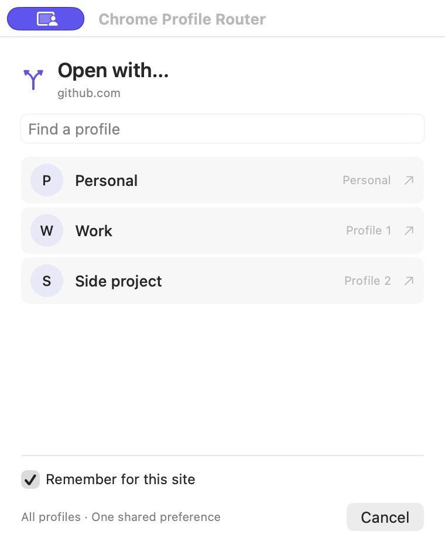
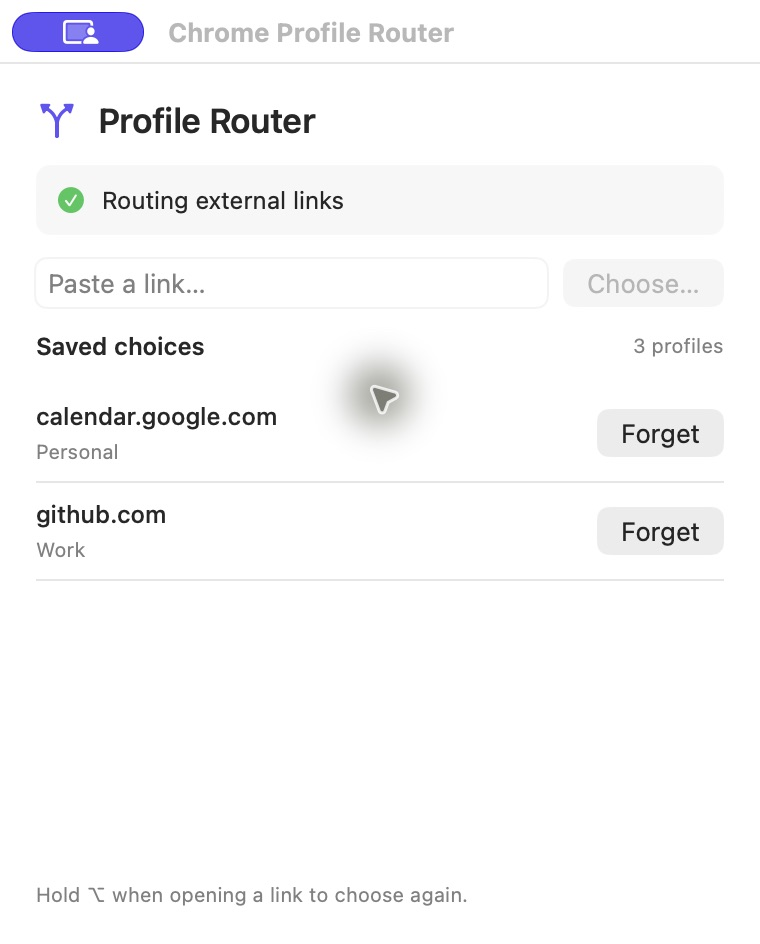

# Chrome Profile Router

Chrome opens links from other apps in whichever profile you used last. If you switch between work and personal profiles, that gets annoying fast.

This little macOS app asks which profile you want the first time you open a site. Pick one, leave **Remember for this site** checked, and future links go straight there. It finds your existing Chrome profiles and shares your choices across all of them.

<p>
  
  
</p>

Screenshots show the real interface with sample profiles.

## Have your agent set it up

Copy this into your coding agent:

```text
clone https://github.com/colingrob/chrome-profile-router and set it up to route my chrome deeplinks
```

## Install

You need macOS 13 or later, Google Chrome, Python 3, and Apple's command line tools. Run `xcode-select --install` if you don't have the tools. This builds the app locally for your Mac.

```sh
git clone https://github.com/colingrob/chrome-profile-router.git
cd chrome-profile-router
bash scripts/install.sh
open "$HOME/Applications/Chrome Profile Router.app"
```

Click **Set up**, then select **Chrome Profile Router** under **System Settings → Desktop & Dock → Default web browser**. Chrome still opens your pages; the router chooses the profile first.

That's enough for links from other apps. You don't need to install an extension in every profile. The app starts automatically when a link needs it, including after a reboot.

## Optional Chrome extension

The extension adds a toolbar button for reopening the current page in another profile, plus an **Open in a Chrome profile…** option when you right-click a link. It keeps the original tab open.

1. Open `chrome://extensions` in the profile where you want the button.
2. Turn on **Developer mode** and click **Load unpacked**.
3. Select `~/Library/Application Support/Chrome Profile Router/extension`. In the folder picker, press **⌘⇧G** to paste that path.
4. Repeat in any other profiles where you want the toolbar button.

The installer registers the extension's native messaging helper for your macOS account. The extension only requests `activeTab`, `contextMenus`, and `nativeMessaging` permissions.

## Everyday use

- Leave **Remember for this site** checked to save your choice. Uncheck it to open just this link in a different profile.
- Hold **Option** while opening an external link to choose again. The toolbar extension or the app's paste field also opens the picker regardless of a saved choice.
- Use the menu bar icon to see saved choices. Click **Forget** to be asked again next time.

Choices saved through the picker match an exact hostname. `github.com` and `gist.github.com` have separate choices, as do different nonstandard ports. A shared login domain gets one remembered profile; use a one-time choice when you need another account.

The router handles external `http` and `https` links sent to your default browser. An app that explicitly launches Chrome bypasses it. Custom app schemes such as `slack://` keep their usual handlers, and links clicked inside Chrome stay in that profile unless you use the extension.

## Let an agent configure rules

You can ask your agent to send particular URLs to a profile or always ask which profile to use. It edits `~/Library/Application Support/Chrome Profile Router/routing-rules.json`, an ordered list of standard regex patterns and destinations. The first matching rule wins, before saved website choices. Changes apply on the next link without restarting the app.

The app includes `--profiles`, `--validate-rules`, and `--explain URL` commands so an agent can find profile IDs and test its changes without opening links. See [the rule format and agent workflow](docs/routing-rules.md).

## What runs locally

The app reads Chrome's profile names and directories from its `Local State` file. It stores hostname-to-profile choices in `~/Library/Application Support/Chrome Profile Router/rules.json` and agent-authored patterns in the separate `routing-rules.json` file. It doesn't read cookies or passwords, record visited URLs, or send analytics. URL paths, query strings, and fragments are passed through to Chrome.

The native helper uses Chrome's [native messaging API](https://developer.chrome.com/docs/extensions/develop/concepts/native-messaging) to pass toolbar requests to the app. Chrome's extension APIs don't provide a general profile-switching API, so the macOS companion does the routing.

## Develop

```sh
bash scripts/build.sh
bash scripts/test.sh
```

Tests also need Node.js. They cover URL handling, profile discovery, persistent choices, regex rules, precedence, invalid configurations, the agent CLI, and the native messaging protocol. The live macOS checks cover both profile directions, remembered choices, one-time overrides, queued links, HTTPS, encoded URLs, and restarting the router. The extension hasn't been tested loaded into Chrome yet; its JavaScript syntax and native host protocol have been checked.

Quit the app before running the installer again to update it. Your saved choices stay in place. See [AGENTS.md](AGENTS.md) for the agent setup checklist.

To stop using it, change your default browser back to Chrome. You can then remove the app from `~/Applications` and the optional extension from Chrome. The support folder and `~/Library/Application Support/Google/Chrome/NativeMessagingHosts/local.colin.chrome_profile_router.json` are the remaining local files.

MIT licensed.
